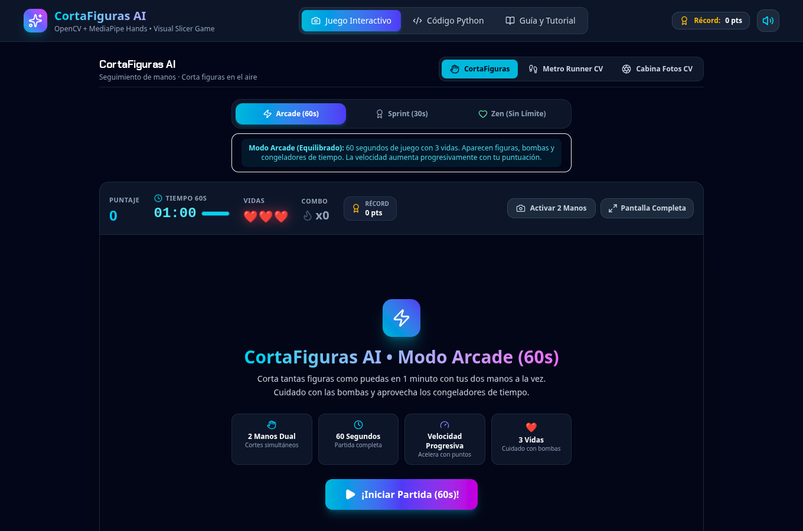
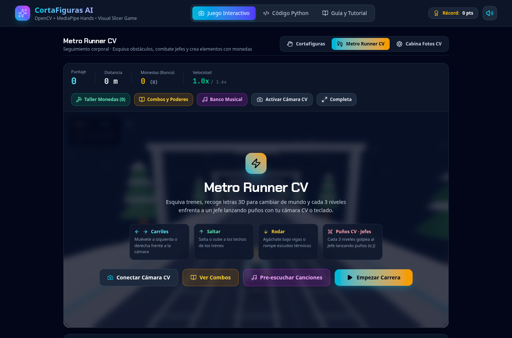
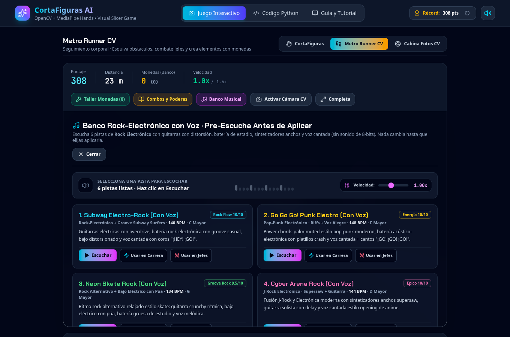
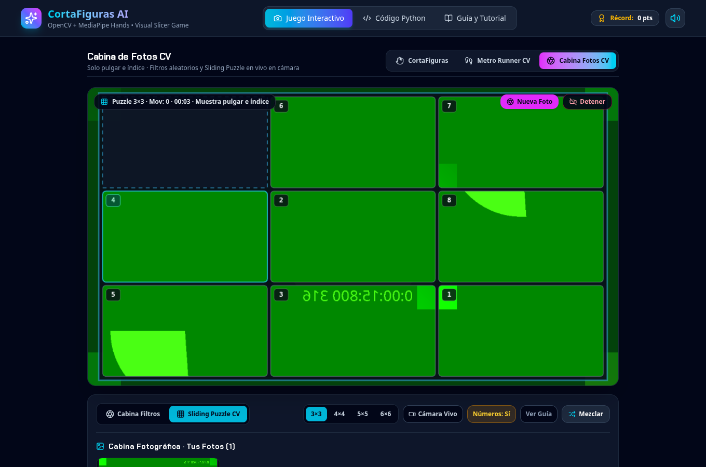
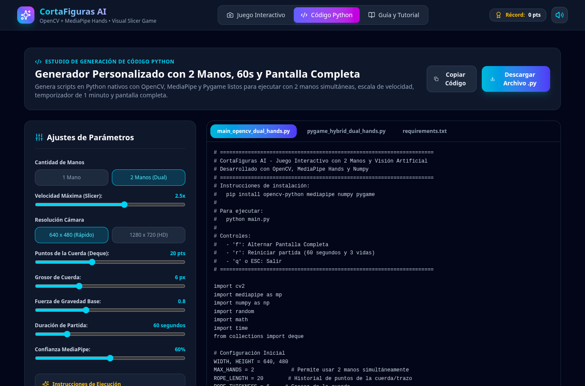

# CortaFiguras AI · Suite Interactiva de Visión Artificial (CV)

Aplicación web interactiva de **Visión Artificial en tiempo real** construida con **React 19**, **TypeScript**, **Tailwind CSS**, **Three.js**, **MediaPipe Hands & Pose** y síntesis musical procedural en **Web Audio API**.

Incluye tres experiencias jugables con cámara (y controles alternativos por teclado/táctil), un estudio generador de scripts Python para escritorio y una guía técnica interactiva.

---

## Pantallas de la Interfaz

### 1. CortaFiguras AI (Seguimiento Dual de Manos)
Juego tipo *fruit-slicer* con seguimiento simultáneo de ambas manos (`MediaPipe Hands`), modos **Arcade (60s · 3 vidas)**, **Sprint (30s · x2 en combos)** y **Zen (sin límite)**, estela luminosa de dedos, bombas y congeladores de tiempo.



---

### 2. Metro Runner CV — Pantalla de Inicio
Juego 3D en **Three.js** controlado con postura corporal (`MediaPipe Pose`) o teclado/deslizamiento: cambio entre 3 carriles, salto sobre trenes, agachado bajo vigas y puños frontales para lanzar ataques elementales.



---

### 3. Metro Runner CV — Jugando · Indicador de Carga de Combo y Umbral x10
HUD de combate y carrera en tiempo real que incluye:
- **Carga de Combo · Umbral x10 (`0 → 1,000`)**: Barra segmentada con marcador explícito del **Umbral 1,000** que activa **Invulnerabilidad total + Multiplicador de Daño x10 + Destrucción de obstáculos** durante 10 segundos.
- **Cadena de Combo Visual**: 4 ranuras (`IZQ ❄️` / `DER 🔥`) con vista previa del siguiente golpe y barra de temporizador de cadena.
- **Medidores de Detección de Puños**: Barras de extensión en vivo para puño izquierdo (Bola de Nieve) y puño derecho (Bola de Fuego) normalizadas por ancho de hombros.


---

### 4. Metro Runner CV — Banco Rock-Electrónico con Voz (Pre-Escucha)
Selector de música procedural con **6 pistas de Rock Electrónico** (guitarras con distorsión, batería de estadio, bajo híbrido, sintetizadores anchos y voz cantada con coros), visualizador de ritmo en vivo, control de velocidad (`0.90x–1.15x`) y asignación independiente para **Carrera** y **Jefes**.



---

### 5. Metro Runner CV — Taller de Monedas y Elementos Creados
Banco persistente de monedas para fabricar elementos consumibles durante la carrera (**Escudo Criogénico**, **Imán Dorado x2**, **Núcleo de Poder +250**) o canjear monedas directamente por puntos.


---

### 6. Metro Runner CV — Poderes de Brazos y Combos de Boxeo
Guía en partida de los ataques elementales (**Bola de Nieve Crio** / **Bola de Fuego Solar**), los 4 combos encadenados (**1-2 Clásico**, **Demoledor Rompe-Muros**, **Martillo Rompe-Escudos**, **Ráfaga Campeón**) y el **Poder Supremo x10**.


---

### 7. Cabina de Fotos CV — Filtros Ópticos en Vivo
Cabina fotográfica multipersona (`maxNumHands: 6`) basada únicamente en **pulgar e índice**:
- **Cierra y vuelve a abrir pulgar e índice** para cambiar automáticamente a un filtro aleatorio entre **16 lentes y efectos** (Ojo de Pez 8mm, Prisma RGB, Cámara Y2K, CRT Glitch VHS, Caleidoscopio, Fuego Solar, Corazones Flotantes, Halo Neón, entre otros).
- **Levanta índice + corazón en V (`✌️`)** para iniciar una cuenta regresiva de 3 segundos y capturar toda la pantalla.


---

### 8. Cabina de Fotos CV — Sliding Puzzle sobre Cámara en Tiempo Real
Al tomar una foto con el gesto `✌️` o **Captura Instantánea**, la captura se divide automáticamente sobre el video en vivo en tableros configurables (**3×3**, **4×4**, **5×5**, **6×6**) para deslizar las piezas directamente con la mano (pulgar e índice) o clic, conservando la tira de fotos en la parte inferior.



---

### 9. Estudio de Código Python
Generador personalizable de scripts nativos en Python (`OpenCV`, `MediaPipe` y `Pygame`) con ajuste de número de manos, resolución, velocidad máxima, duración y nivel de confianza para copiar o descargar en `.py`.



---

### 10. Guía y Tutorial Técnico
Documentación didáctica integrada sobre el funcionamiento del seguimiento de 2 manos, curvas de velocidad progresiva, temporizador de partidas y modo pantalla completa.


---

## Tecnologías Principales

- **Frontend:** React 19, TypeScript, Tailwind CSS v4, Lucide Icons
- **Gráficos 3D:** Three.js (`RoomEnvironment`, iluminación dinámica y sistemas de partículas)
- **Visión Artificial:** `@mediapipe/hands`, `@mediapipe/pose`, `@mediapipe/camera_utils`
- **Audio Procedural:** Web Audio API (guitarras con `WaveShaperNode`, reverb convolucional, delay, batería y síntesis vocal por formantes)
- **Empaquetado:** Vite 6

---

## Ejecución Local

```bash
# 1. Instalar dependencias
npm install

# 2. Iniciar servidor de desarrollo (puerto 3000)
npm run dev

# 3. Verificar tipos y generar build de producción
npm run lint
npm run build
```
