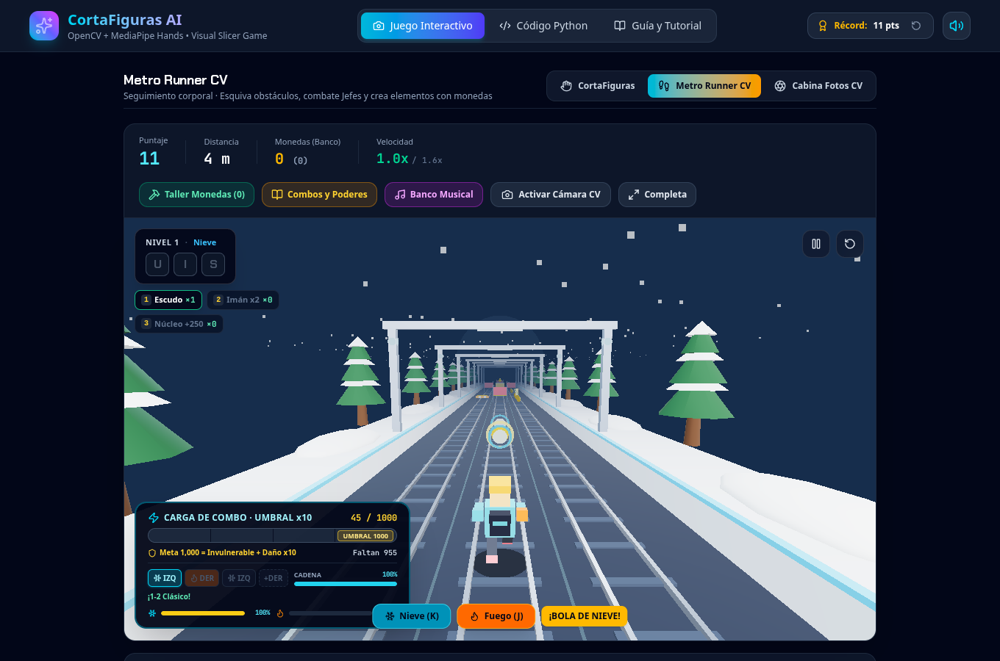
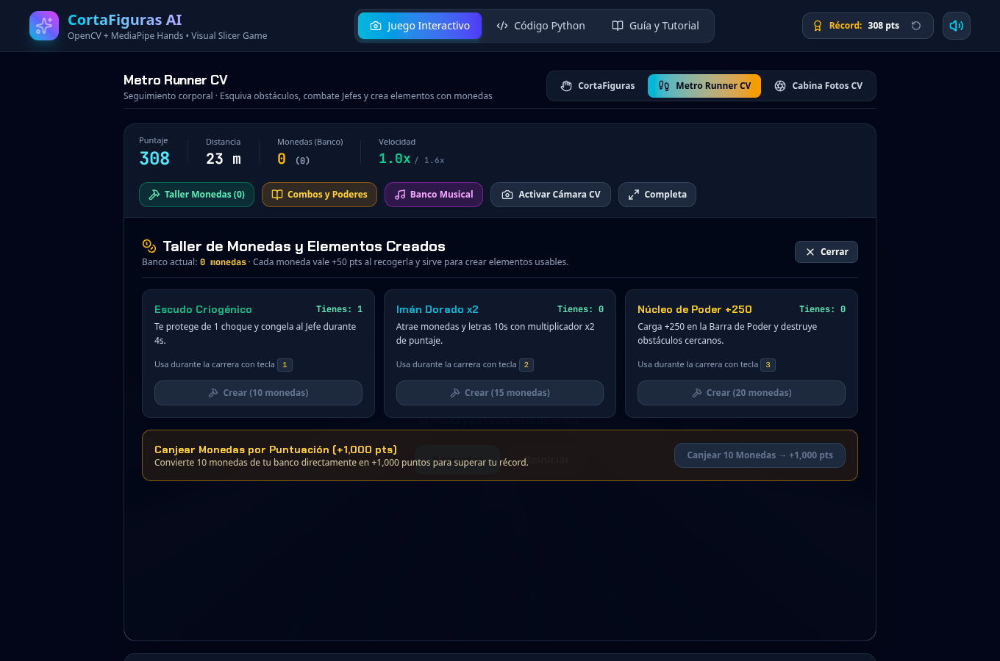
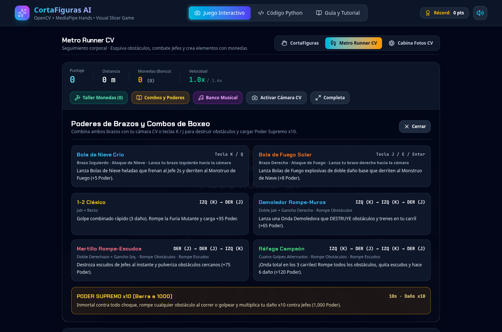
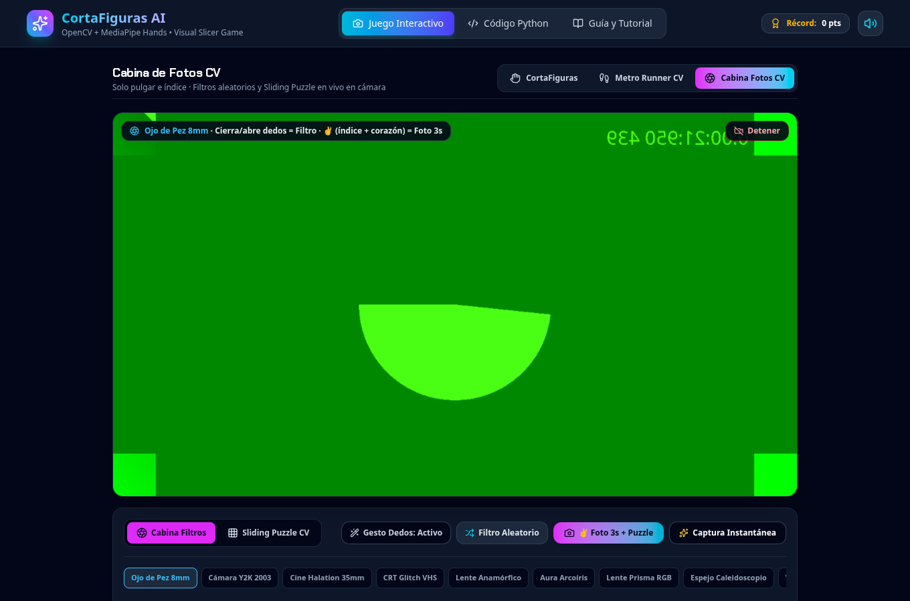
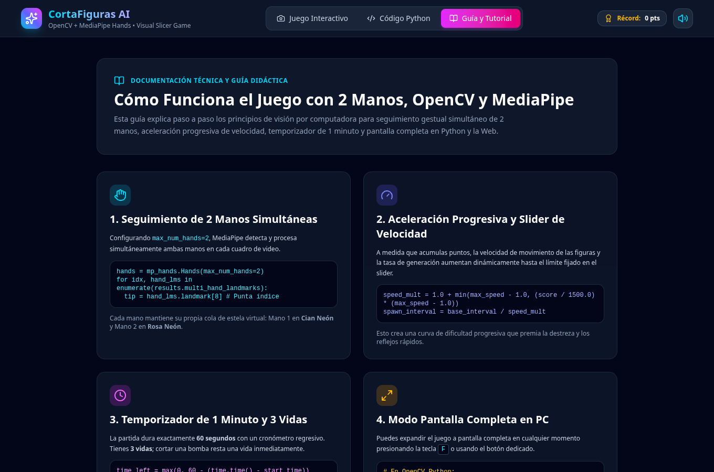

# EraBotGames · Suite Interactiva de Visión Artificial (100% Offline)

> **Programa hecho por:** Carlos Stiven Roa · **Grupo:** CEMOS · **Semillero:** ERA

Aplicación web interactiva de **Visión Artificial en tiempo real 100% offline** construida con **React 19**, **TypeScript**, **Tailwind CSS**, **Three.js**, **MediaPipe Hands & Pose** (empaquetados localmente en `public/mediapipe/`), fuentes locales (`@fontsource`) y síntesis musical procedural en **Web Audio API**.

Al iniciar presenta una **introducción cinematográfica estilo Star Wars** con créditos animados en perspectiva 3D y starfield en tiempo real (con opción para activar fanfarria épica, saltar con `Espacio` o repetir desde el botón **Intro**).

---

## Pantallas de la Interfaz

### 1. CortaFiguras · EraBotGames (Seguimiento Dual de Manos)
Juego tipo *fruit-slicer* con seguimiento simultáneo de ambas manos (`MediaPipe Hands`), modos **Arcade (60s · 3 vidas)**, **Sprint (30s · x2 en combos)** y **Zen (sin límite)**, estela luminosa de dedos, bombas y congeladores de tiempo.


---

### 2. Metro Runner CV — Pantalla de Inicio
Juego 3D en **Three.js** controlado con postura corporal (`MediaPipe Pose`) o teclado/deslizamiento: cambio entre 3 carriles, salto sobre trenes, agachado bajo vigas y puños frontales para lanzar ataques elementales.


---

### 3. Metro Runner CV — Jugando · Barras Verticales Izquierda y Derecha + Jefes a Distancia
HUD limpio con **dos barras verticales compactas** en los costados para mantener el centro 3D completamente despejado:
- **Barra Vertical Izquierda (`PODER · 0 → 1,000`)**: Medidor ascendente con marcador explícito del **Umbral 1,000** para activar **Invulnerabilidad total + Daño x10 + Destrucción de obstáculos** durante 10 segundos.
- **Barra Vertical Derecha (`COMBO ACTUAL`)**: Muestra el combo activo o en cadena, 4 ranuras verticales (`IZQ ❄️` / `DER 🔥`) con vista previa del siguiente golpe, temporizador vertical de cadena y medidores en vivo de empuje de ambos puños.
- **Jefes al Fondo que Lanzan Obstáculos**: Cada 3 niveles, los Jefes aparecen al fondo del túnel (`z = -48`) y lanzan obstáculos en arco parabólico hacia las vías.



---

### 4. Metro Runner CV — Banco Rock-Electrónico con Voz (Pre-Escucha)
Selector de música procedural con **6 pistas de Rock Electrónico** (guitarras con distorsión, batería de estadio, bajo híbrido, sintetizadores anchos y voz cantada con coros), visualizador de ritmo en vivo, control de velocidad (`0.90x–1.15x`) y asignación independiente para **Carrera** y **Jefes**.


---

### 5. Metro Runner CV — Taller de Monedas y Elementos Creados
Banco persistente de monedas para fabricar elementos consumibles durante la carrera (**Escudo Criogénico**, **Imán Dorado x2**, **Núcleo de Poder +250**) o canjear monedas directamente por puntos.



---

### 6. Metro Runner CV — Entrenador de Gestos y Combos Especiales Pre-Juego
Sección interactiva accesible antes de iniciar la carrera para visualizar los comandos de gestos CV (`Puño IZQ` / `Puño DER`) de los 4 combos especiales (**1-2 Clásico**, **Demoledor Rompe-Muros**, **Martillo Rompe-Escudos**, **Ráfaga Campeón**) y practicarlos en vivo con la cámara, teclas `K`/`J` o botones simuladores hasta dominarlos (`Dominados: X/4`).



---

### 7. Cabina de Fotos CV — Filtros de Cine, Magia Dr. Strange y Filtro Único por Mano
Cabina fotográfica multipersona (`maxNumHands: 6`) basada en **pulgar e índice**:
- **Filtro distinto por cada mano detectada**: Cada mano abre su propio portal independiente (`M1`, `M2`, `M3`...) con un efecto diferente al mismo tiempo.
- **Cierra y vuelve a abrir pulgar e índice** en una mano para rotar aleatoriamente su propio filtro entre **26 efectos** incluyendo magia animada (**Magia Dr. Strange**, **Dimensión Espejo**, **Ojo de Agamotto**, **Holograma Galáctico**, **Magia Escarlata**, **Escudo Patronus**, **Pulso Vibranium**, **Cómic Multiverso**, **Neon Blade Runner**, **Mundo del Revés**) y 16 lentes ópticos retro.
- **Levanta índice + corazón en V (`✌️`)** para iniciar una cuenta regresiva de 3 segundos y capturar toda la pantalla.



---

### 8. Cabina de Fotos CV — Sliding Puzzle sobre Cámara en Tiempo Real
Al tomar una foto con el gesto `✌️` o **Captura Instantánea**, la captura se divide automáticamente sobre el video en vivo en tableros configurables (**3×3**, **4×4**, **5×5**, **6×6**) para deslizar las piezas directamente con la mano (pulgar e índice) o clic, conservando la tira de fotos en la parte inferior.


---

### 9. Estudio de Código Python
Generador personalizable de scripts nativos en Python (`OpenCV`, `MediaPipe` y `Pygame`) para **CortaFiguras** (`corta_figuras.py` / `corta_figuras_pygame.py`), **Cabina Mágica CV** (`cabina_fotos_magia_cv.py` con filtro distinto por mano y mandala Dr. Strange) y **Metro Runner Pose** (`metro_runner_pose_cv.py` con barras laterales y combos x10).


---

### 10. Guía y Tutorial Técnico
Documentación didáctica integrada sobre toda la suite offline (`Iniciar_EraBotGames.bat`), seguimiento dual de manos, pose corporal con combos x10, jefes a distancia y cabina multifiltro con magia animada.



---

## Tecnologías Principales

- **Frontend:** React 19, TypeScript, Tailwind CSS v4, Lucide Icons
- **Gráficos 3D:** Three.js (`RoomEnvironment`, iluminación dinámica y sistemas de partículas)
- **Visión Artificial:** `@mediapipe/hands`, `@mediapipe/pose`, `@mediapipe/camera_utils`
- **Audio Procedural:** Web Audio API (guitarras con `WaveShaperNode`, reverb convolucional, delay, batería y síntesis vocal por formantes)
- **Empaquetado:** Vite 6

---

## Ejecución Offline en PC (Windows `.bat` sin Internet)

Todo el proyecto incluye las tipografías y los modelos WASM/TFLite de **MediaPipe Hands & Pose** en local para verse y funcionar **exactamente igual sin conexión a internet**:

1. Si es la primera vez en un equipo con Node.js instalado, genera la compilación lista para llevar offline (o deja que el `.bat` la genere una sola vez):
   ```bash
   npm install
   npm run build
   ```
2. En cualquier PC Windows (incluso **100% sin internet** una vez compilada la carpeta `dist/`), haz doble clic en:
   ```text
   Iniciar_EraBotGames.bat
   ```
   Este lanzador inicia un servidor HTTP local ultra-ligero (`scripts/serve-offline.mjs`) en `http://localhost:3000` (con soporte nativo para `.wasm`, `.tflite`, `.data` y cámara web) y abre **EraBotGames** automáticamente en tu navegador.

### Comandos de Desarrollo

```bash
# Sincronizar activos offline y levantar servidor dev (puerto 3000)
npm run dev

# Verificar tipos y generar compilación offline en dist/
npm run lint
npm run build

# Servir la versión compilada en modo offline desde terminal
npm run start:offline
```
